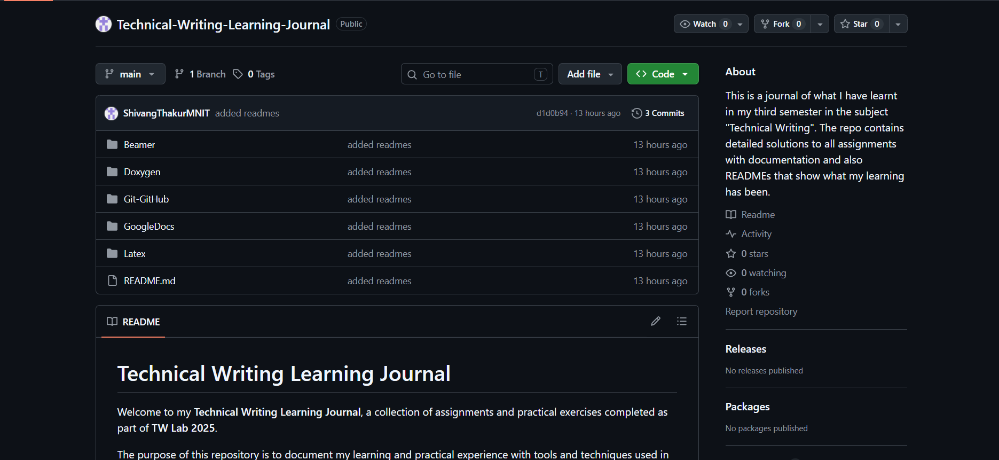

# Git and GitHub — Learning the Basics of Version Control

## Overview

This folder contains my work on the Git Basics assignment (Assignment 810) from TW Lab 2025.

The exercise introduced me to Git as a version control system and focused on understanding how changes to a project can be tracked, saved, inspected, and reversed.

I performed the exercises in a Linux-like environment using **Windows Subsystem for Linux (WSL)**. The submission contains terminal screenshots and short explanations documenting the commands and their effects.

## Assignment Objective

The assignment involved creating a small project directory and using Git to manage the files inside it.

The sample project included a Python file named `vecadd.py`, intended to accept two vectors and print their dot product. A separate `readme.txt` file was used to practise the basic Git workflow.

## Commands and Concepts Explored

### 1. Initializing a Repository

I began by creating a project directory and initializing it as a Git repository:

```bash
git init
```

This creates the repository's Git metadata and allows Git to track changes within the project.

### 2. Configuring Git

I configured the username and email associated with commits:

```bash
git config user.name "Your Name"
git config user.email "username@provider.com"
```

This establishes the author information recorded in the commit history.

### 3. Staging Files and Checking Status

I created `readme.txt`, added a description of the project, and staged it:

```bash
git add readme.txt
git status
```

This introduced the staging area, which allows changes to be selected before they become part of a commit.

### 4. Creating Commits

I saved the staged changes in the repository:

```bash
git commit -m "Adding first file."
```

I then checked the repository status again to observe the state of the working directory after committing.

### 5. Inspecting Changes

After modifying `readme.txt`, I used:

```bash
git diff
```

This displays differences between the working directory and the staged version, helping identify exactly what has changed.

### 6. Restoring Changes

I experimented with `git restore` to understand how it behaves when changes are unstaged and when they have already been staged.

The important distinction is that restoring a working-tree file and removing a file from the staging area are separate operations:

```bash
git restore <file>
git restore --staged <file>
```

The exercise also explored restoring both staged and working-tree changes.

### 7. Viewing Commit History

I used:

```bash
git log
```

This displays the repository's commit history, including commit hashes and other information.

### 8. Reverting a Commit

I used:

```bash
git revert <commit-hash>
```

This demonstrated an important feature of Git: reverting a commit creates a new commit that reverses the changes introduced by an earlier commit. The original commit remains in the history.

### 9. Adding the Python Program

I added the `vecadd.py` program to the repository and committed it using the commands practised earlier.

The assignment uses this file to apply the version control workflow to an actual source file rather than only a text file.

### 10. Removing a File

I removed `readme.txt` using:

```bash
git rm readme.txt
```

I then committed the removal so that the deletion was recorded in the repository history.

### 11. Checking Out an Earlier Commit

I used:

```bash
git checkout <commit-hash>
```

This allowed me to inspect the state of the project at an earlier commit.

Unlike `git revert`, checking out an earlier commit does not create a new commit that reverses changes. Checking out a specific commit can also place Git in a detached HEAD state.

### 12. Returning to the Latest Branch

Finally, I returned to the latest version of the branch:

```bash
git checkout <branch-name>
```

This restored the working directory to the branch's current committed state.

## What I Learned

The assignment helped me understand the distinction between the working directory, staging area, and commit history.

Some of the most useful concepts I took away were:

- `git add` selects changes for the next commit.
- `git commit` records staged changes in the repository history.
- `git status` provides an overview of the current repository state.
- `git diff` helps inspect modifications before committing.
- `git restore` can discard working-tree changes or unstage changes.
- `git revert` undoes changes by creating another commit.
- `git checkout` can be used to inspect an earlier version of a project.

One particularly useful part of the exercise was comparing `git revert` and `git checkout`. Although both can help when working with older versions of a project, they serve different purposes and affect the repository in different ways.

## Submission

The assignment submission is provided as a PDF containing screenshots of the terminal operations and brief explanations of each step.

## Screenshots

