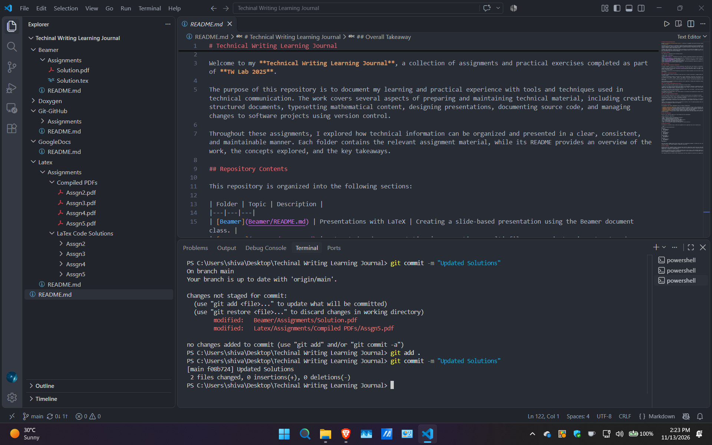

# Technical Writing Learning Journal

Welcome to my **Technical Writing Learning Journal**, a collection of assignments and practical exercises completed as part of **TW Lab 2025**.

The purpose of this repository is to document my learning and practical experience with tools and techniques used in technical communication. The work covers several aspects of preparing and maintaining technical material, including creating structured documents, typesetting mathematical content, designing presentations, documenting source code, and managing changes to software projects using version control.

Throughout these assignments, I explored how technical information can be organized and presented in a clear, consistent, and maintainable manner. Each folder contains the relevant assignment material, while its README provides an overview of the work, the concepts explored, and the key takeaways.

## Repository Contents

This repository is organized into the following sections:

| Folder | Topic | Description |
|---|---|---|
| [Beamer](Beamer/README.md) | Presentations with LaTeX | Creating a slide-based presentation using the Beamer document class. |
| [Doxygen](Doxygen/README.md) | Automated Code Documentation | Documenting a multi-file C++ project using structured comments and generating documentation with Doxygen. |
| [Git-GitHub](Git-GitHub/README.md) | Version Control with Git | Learning the fundamentals of Git, including commits, staging, inspecting changes, and navigating project history. |
| [Latex](Latex/README.md) | Document Preparation with LaTeX | Exploring mathematical typesetting, equations, tables, figures, formatting, and structured technical documents. |

## Work and Learning

### 1. Beamer — Creating Technical Presentations

The Beamer assignment introduced me to creating presentations using LaTeX rather than relying on a conventional slide editor.

I prepared a short presentation titled *Introduction to LaTeX*, covering what LaTeX is, where it is useful, and how a typical LaTeX document is structured. The exercise involved working with presentation themes, title pages, frames, lists, and basic formatting commands.

This helped me understand how the same typesetting system used for technical documents can also be used to create organized presentations.

### 2. Doxygen — Documenting Source Code

The Doxygen assignment focused on documenting a small multi-file C++ project consisting of a logging system and a calculation engine.

I worked with documentation comments to describe files, classes, enumerations, constructors, and functions. I also explored how commands such as `@brief`, `@param`, `@return`, and `@details` can be used to make source code easier to understand.

Another part of the exercise involved configuring Doxygen through a `Doxyfile` and generating documentation from the project source files.

This introduced me to automated documentation generation and the importance of keeping code documentation organized alongside the implementation.

### 3. Git and GitHub — Understanding Version Control

The Git Basics assignment provided a practical introduction to version control.

I created a local repository and experimented with commands for initializing a repository, configuring user information, staging files, and creating commits. I also explored how to inspect changes, view commit history, restore modifications, remove files, and navigate to earlier versions of a project.

A particularly useful part of this exercise was comparing `git revert` and `git checkout`, since they provide different ways of working with previous versions of a project.

The assignment also involved adding a small Python program to the repository and documenting the terminal operations through screenshots and explanations.

### 4. LaTeX — Preparing Technical Documents

The LaTeX assignments explored the use of LaTeX for creating structured technical and mathematical documents.

The exercises covered a range of topics, progressing from mathematical expressions and equations to more complex layouts involving tables, figures, lists, colours, and document formatting.

I worked with mathematical environments, matrices, aligned equations, and piecewise expressions. I also explored table formatting, image placement, custom colours, and the organization of longer documents using chapters, sections, headers, and footers.

Together, these exercises provided a practical introduction to LaTeX as a tool for preparing documents where structure, consistency, and mathematical notation are important.

## Key Areas of Learning

The assignments cover several complementary areas of technical communication:

- **Technical writing and organization:** Structuring information so that it is easier to read, understand, and navigate.
- **Document preparation:** Using LaTeX commands, environments, and packages to create consistent technical documents.
- **Mathematical typesetting:** Representing equations, matrices, symbols, and other mathematical expressions clearly.
- **Presentation design:** Organizing technical information into slides using LaTeX Beamer.
- **Software documentation:** Writing structured comments and generating documentation from C++ source code using Doxygen.
- **Version control:** Tracking project changes, maintaining commit history, and understanding how to work with earlier versions using Git.

## Tools and Technologies

The work in this repository makes use of the following tools and technologies:

| Tool / Technology | Application |
|---|---|
| LaTeX | Preparing technical and mathematical documents |
| Beamer | Creating presentations using LaTeX |
| Doxygen | Generating documentation from source code |
| C++ | Implementing the sample calculation and logging project |
| Git | Tracking changes and managing project history |
| Python | Creating the sample vector dot-product program |
| Linux / WSL | Providing the command-line environment for the Git exercises |

## Repository Structure

The repository is divided by topic so that each assignment and its supporting files can be located easily.

```text
Technical-Writing-Learning-Journal/
│
├── Beamer/
│   ├── Assignments/
│   └── README.md
│
├── Doxygen/
│   ├── Assignments/
│   ├── Solution/
│   └── README.md
│
├── Git-GitHub/
│   ├── Assignments/
│   └── README.md
│
├── Latex/
│   ├── Assignments/
│   └── README.md
│
└── README.md
```

Each topic-specific README provides further details about its corresponding assignment, including the files involved, the concepts practised, and relevant commands or compilation instructions.

## Overall Takeaway

Working through these assignments helped me appreciate that technical communication involves much more than simply writing explanations. It also requires presenting information effectively, maintaining consistency, documenting technical work, and keeping track of changes as a project develops.

The exercises introduced me to tools that address different parts of this process. LaTeX and Beamer helped me work with structured documents and presentations, Doxygen demonstrated how software documentation can be generated from source code, and Git introduced me to systematic version control.

This repository serves as a record of that learning process and brings together the practical work completed during the lab.

## Screenshots

